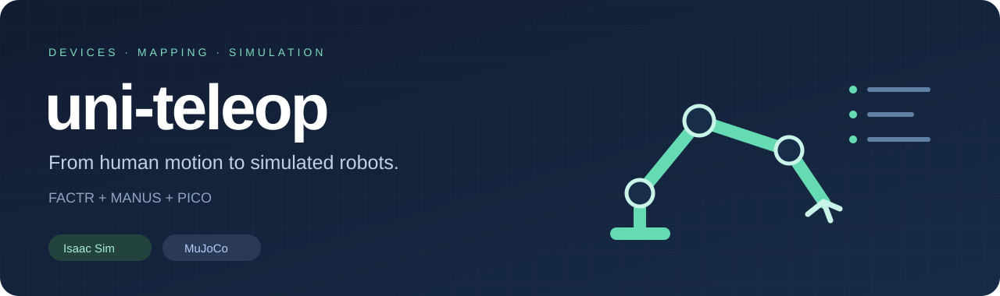
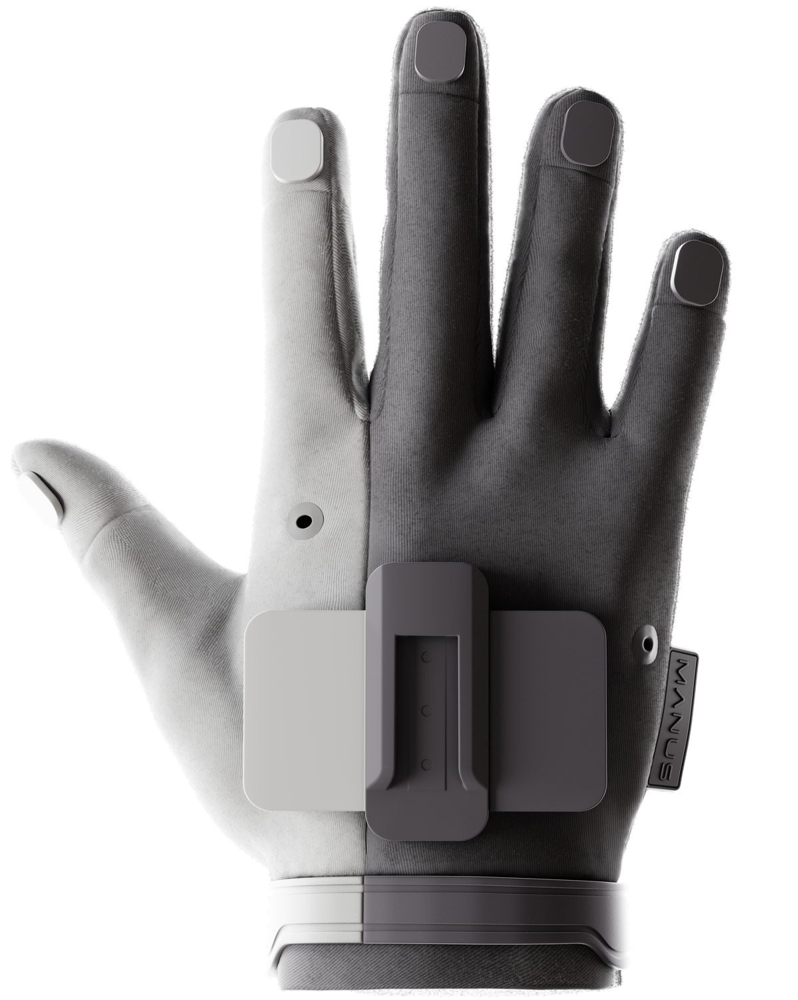
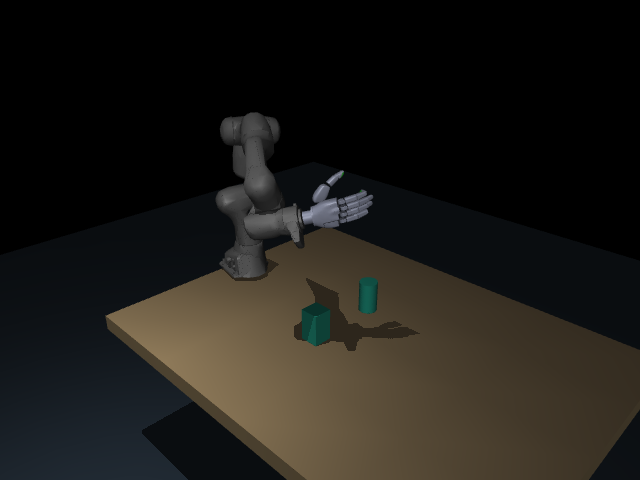
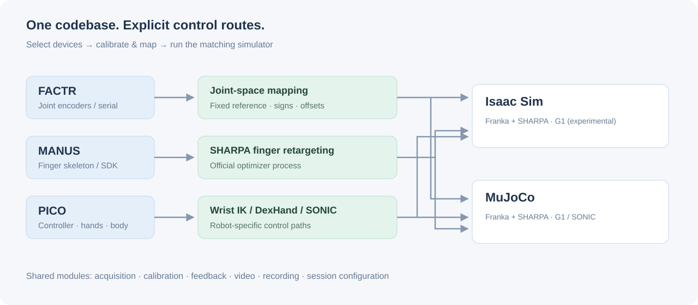

<p align="center"></p>

<p align="center"><strong>One place for simulation teleoperation.</strong><br>FACTR · PICO · MANUS → robot mappings → Isaac Sim / MuJoCo</p>

<p align="center"><a href="#quick-start">Quick start</a> · <a href="#choose-your-setup">Supported setups</a> · <a href="docs/setup.md">Installation</a> · <a href="docs/operation.md">Operator guide</a> · <a href="docs/integration.md">Architecture</a></p>

uni-teleop 把**设备采集、机器人映射、仿真后端**分开。同一份 FACTR 标定、PICO 输入协议和 MANUS 手指映射可以用于两个仿真器；使用者选择设备组合，而不必先理解两个原始项目的目录。

面向两类操作：**Franka＋SHARPA 桌面操作**，以及 **G1＋SONIC 全身遥操**。集成来源为 DexBench 和 sonic-mujoco，原始版本、修改与验证范围均保留在仓库中。

## Choose your setup

| 输入组合 | 控制对象 | Isaac Sim | MuJoCo |
|---|---|---|---|
| FACTR 主臂＋扳机 | 七轴关节＋手指开合 | `isaac-factr` | `mujoco-factr` |
| FACTR 主臂＋MANUS | 七轴关节＋独立手指 | `isaac-factr-manus` | `mujoco-factr-manus` |
| PICO 手柄 | 腕部位姿＋扳机开合 | `isaac-pico-controllers` | `mujoco-pico-controllers` |
| PICO 裸手 | 腕部位姿＋手指 | `isaac-pico-hands` | `mujoco-pico-hands` |
| PICO 手柄＋MANUS | 腕部位姿＋独立手指 | `isaac-pico-manus` | `mujoco-pico-manus` |
| MANUS 单独测试 | 保持机械臂，控制手指 | `isaac-manus` | `mujoco-manus` |
| PICO 全身＋双手 | G1 / SONIC | `isaac-sonic` **实验性** | `mujoco-sonic` |

**支持范围：**Franka 两端共用设备和映射代码。新增 MuJoCo 路线使用 URDF 构建的练习工作台，并已做合成输入和原生物理检查；DexBench 任务资产与评分目前仍在 Isaac 端。G1 的 Isaac 端已实现模型导入、71 轴驱动、29 轴身体状态和 SONIC 接口；策略跨引擎稳定性与实机 PICO 尚待验证，不能据此认定全身遥操已达到 MuJoCo 的效果。详见 [验证记录](docs/validation.md)。

保留 `mujoco-pico` 的原 SONIC 多场景、相机和记录流程，以及 G1/H2 模型自检、SIMPLE 外部适配。`superdex-hands` 是 **SuperDex 独立物理引擎**，`pico-superdex-source` 是其输入发布端；它们不是 MuJoCo 的别名。

## Quick start

```bash
git clone https://github.com/shutongliu-dev/uni-teleop.git
cd uni-teleop
./teleop list

# 为你的设备生成最小配置；不会启动设备或让主臂出力
./teleop configure mujoco-factr-manus --output local/session.json
# 按 docs/setup.md 安装环境，填写 local/session.json 中的路径和设备配置
./teleop doctor local/session.json
./teleop run local/session.json --dry-run
./teleop run local/session.json
```

换仿真后端时，选相同后缀的 recipe，例如 `isaac-factr-manus`。两个配置可复用同一份 FACTR 与 MANUS 标定文件；仿真 Python、数据目录等环境设置分别填写。`configure` 只生成当前组合需要的字段；所有 `local/` 文件默认被 Git 忽略。

**Franka：**默认暂停，空格开始/暂停。PICO 手柄按住 grip 移动，松开重新抓取控制位置；MANUS 组合由手套控制手指。FACTR 使用保存的逐关节方向与偏置，Start 不偷偷重记零点。实体托举必须显式配置并启用。[操作与排错 →](docs/operation.md)

## Hardware & views

<table>
<tr><td width="50%"></td><td></td></tr>
<tr><td>MANUS Metagloves Pro — 官方产品示意图，版权归 MANUS；不是本仓库测试照片。</td><td>新增 MuJoCo 工作台原生渲染：Franka、SHARPA、桌面和两个刚体。使用碰撞网格外观，不代表完整 DexBench 场景。</td></tr>
</table>

图片来源及使用说明见 [assets credits](docs/assets/README.md)。

## Codebase



```text
uni_teleop/
  devices/      # FACTR / PICO / MANUS 输入，独立 SDK 进程
  mapping/      # 关节标定、腕部 IK、手指重定向、SONIC
  core/         # 公共输入、状态和控制命令
  runtime/      # 会话组合与生命周期
  backends/     # MuJoCo Franka、Isaac G1 等后端适配
  feedback/     # FACTR 重力补偿/阻尼与接触反馈模块
  video/        # 视角、视频桥、桌面显示
  recording/    # 帧与轨迹记录
configs/        # 可组合组件、recipe 注册表、匿名示例
backends/
  isaac/        # DexBench 原生引擎、任务与模型支持
  mujoco/       # SONIC 模型、原有场景与引擎支持
```

设备实现已经抽取到公共包，`backends/` 不再各自维护一份遥操设备代码。新增设备改 `devices/`，新增映射改 `mapping/`，新增引擎实现对应状态/命令接口。不要把 SDK、标定和机器路径写进源代码。[开发指南 →](docs/integration.md)

## Provenance & validation

- [来源、授权与外部依赖](THIRD_PARTY.md) · [原始源码清单](sources.lock.json) · [模块迁移记录](docs/provenance/module-migration.json)
- [可复现检查与验证边界](docs/validation.md)
- SDK、授权文件、策略权重和 DexBench 数据需自行安装；仓库不包含个人设备标识或采集记录。
- 这是持续整合的研究代码库。原项目的测试基线、合成验证、真实硬件结果分别记录，不混用为“全部验证通过”。
