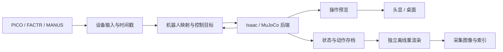
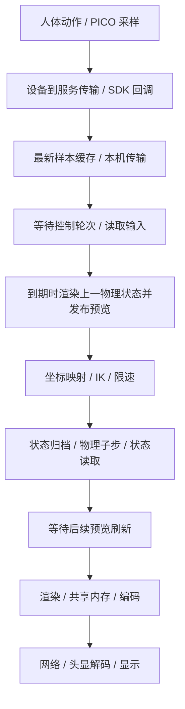

# uni-teleop 项目总结与问题分析

更新日期：2026-11-04。本文用于项目复盘、面试准备与后续优化交接。描述截至本次工作的实现和证据，不将规划写成已完成能力。

## 1. 项目定位与贡献边界

uni-teleop 是由项目作者搭建的统一机器人遥操与示范数据采集框架。目标是将不同设备、机器人和仿真后端中的采集、映射、执行与记录逻辑解耦，降低重复开发和环境切换成本。

框架集成 DexBench 与 sonic-mujoco 的能力，使用外部设备 SDK、物理引擎和模型资产。作者的贡献包括统一架构、公共模块抽取、设备与后端组合管理、运行环境隔离、遥操流程和采集链路改进；不将上游引擎、策略、模型和算法整体表述为从零自研。来源见 `sources.lock.json`、`docs/provenance/`。

项目覆盖的代码路线包括 FACTR、PICO、MANUS 输入，Franka＋SHARPA、独立 SHARPA 手及 G1＋SONIC，以及 Isaac Sim / MuJoCo 后端。注册了组合不等于完成设备验收；各路线成熟度以 [README](../README.md) 和 [验证记录](validation.md) 为准。FACTR 是主臂，DYNAMIXEL 是其电机／串口实现。

## 2. 架构与设计取舍

| 层次 | 职责 | 设计边界 |
|---|---|---|
| 统一 CLI / runtime | 配置、检查、组合和进程生命周期 | 公共 launcher 不导入 Isaac、MuJoCo 或设备 SDK |
| `devices/` | 获取输入、规范化、时间戳和最新样本 | 不包含机器人控制或仿真引擎实现 |
| `mapping/` | 坐标转换、关节映射、IK、参考与限速 | 输入与机器人的控制语义在这里转换 |
| `backends/` | 模型、任务、物理执行和实际状态读取 | 不复制设备实现；不同引擎不假装物理等价 |
| `feedback/` | 实体反馈与使能管理 | 默认不启用物理反馈，检查配置不使能电机 |
| `video/`、`recording/` | 操作显示、状态与图像记录 | 预览需求与采集数据定义分开 |
| components / recipes | 声明依赖与支持的组合 | 不支持的组合显式报错，不偷偷换管线 |

设备 SDK 和仿真器依赖各自隔离。使用命名关节、明确单位和坐标约定，避免依赖某个引擎的数组顺序。Franka 路线包含 7 个机械臂关节与 22 个 SHARPA 关节；G1 的身体、双手和颈部分别按名称解析。详情见 [架构说明](integration.md)。

### 为什么不把所有后端统一成相同行为？

统一的是输入、控制契约与生命周期，不是各引擎的全部能力。MuJoCo Franka 工作台没有复刻 Isaac 的 DexBench 任务评分；G1 从 MJCF 到 PhysX 的接触、惯量和策略稳定性也需要单独验证。抽象必须保留这些能力差异。

## 3. 场景与运行流程

Isaac 场景基于已有机器人、手、桌面和交互物体资产，由场景配置组织初始位姿、相机和任务参数。后端负责加载模型、设置驱动、推进物理和读取状态；并非从零制作全部资产。

当前实测的 PICO＋Isaac 桌面路线：

1. 加载场景与初始状态，准备操作相机及采集相机。
2. 连接追踪和视频，初始暂停，等待 Start 或踏板恢复。
3. 读取最新输入，映射手柄运动，生成并执行关节目标。
4. 练习模式配置 4 ms 物理子步、40 ms 控制周期，每轮十个子步；物理子步不逐次渲染。
5. 头显使用后上方双目和桌面近景；原采集视角保持独立。
6. 每个有效控制步存储动作前状态与后续动作，暂停时冻结物理、仿真计时与采集。
7. 当前新流程通过 Save episode / Next（F8）封存、重置并暂停，下一条可继续；退出不自动重渲染。
8. 独立渲染命令恢复状态出图，不重新执行动作，不推进物理。

第 7 步的新连续采集流程目前通过 CPU 测试，尚待头显实测。操作命令和目录布局见 [操作说明](operation.md)。

## 4. 问题分析方法与解决过程

分析遵循：明确可观测症状 → 定位所在链路 → 采集日志／计时／事件 → 修改单个关键机制 → 分层验证。用户看到的“卡住”可能来自追踪过期、控制暂停、仿真过慢、编码积压或视频断开，不能统一归因于网络。

| 问题 | 证据与判断 | 改进及边界 |
|---|---|---|
| 持续发追踪仍掉线 | 服务只按独立心跳判断存活，超时会移除设备 | 有效完整追踪包更新连接存活；仍保留姿态新鲜度检查，在线不等于数据有效 |
| 灰白画面、client not connected | 追踪与 Remote Vision 是不同连接，追踪在线不能证明视频畅通 | 分别核对视频控制、视频接收端及编码器；不能只重复重连追踪 |
| 单眼看到两个并排画面 | 先通过单眼测试区分分眼显示模式与双眼配准问题 | 排查客户端显示模式，避免错误调整相机基线 |
| 手柄与末端方向不一致 | 视角调整后，控制参考与显示参考不一致 | 平移和旋转使用一致的视角基准；恢复时重建参考 |
| 主视角遮挡、近处看不清 | 后上方视角适合操作，但局部交互细节不足 | 调整相机位置并增加近水平桌面特写，放到独立区域而非覆盖主画面 |
| 人手伸到极限，机器人仍有余量 | 人体工作空间与机器人可达空间不一致 | 踏板暂停后允许收回手，恢复时重新建立锚点并保留当前目标 |
| 长踩踏板无法触发 | 实际连续踩住时，设备仍只上报约 40 ms 按键脉冲 | 按用户要求移除长踩重置，保留踩下切换；不在软件里猜测持续按压 |
| 操作跟随慢 | 分段耗时显示渲染与物理步进是主要平均开销，IK 有尾部问题 | 优先减少渲染产品与子步数量，再分析 IK 长尾，避免凭感觉更换求解器 |
| 低频预览后 Start 立即暂停 | 控制参考更新依赖下一次渲染 | 将控制基准更新移到每轮控制，不依赖图像刷新 |
| 电脑流畅、头显延迟或冻结 | 视频请求频率与源帧率不同；重复编码与缓冲积压；发送超时后流关闭 | 仅编码新帧、有界缓冲、限制码率，失败后重连并重建编码器；长期头显稳定性仍需验证 |
| 暂停仍消耗场景时限 | 暂停控制目标并没有停止物理推进 | 暂停冻结物理、时间及状态记录，输入和预览继续运行 |
| 高质量图像拖慢遥操 | 控制与多相机渲染争用实时循环 | 先存状态，后恢复状态渲染；降低预览不改变采集相机定义 |
| 重渲染阻塞下一条 | 原先在采集进程退出阶段同步渲染 | 移除自动渲染，独立封存每条 episode，后续单独渲染 |

### 4.1 先区分四种“慢”

| 用户感受 | 对应指标 | 不能混淆的概念 |
|---|---|---|
| 手柄动了，末端过一会儿才开始动 | 输入到命令执行的延迟；命令／实际关节误差 | 输入新鲜不代表命令执行得快 |
| 末端持续跟随，但速度慢、追不上手 | 控制周期、仿真时间／墙钟时间、目标限速、驱动响应 | 低仿真实时率不是单纯的网络延迟 |
| 电脑画面正常，头显仍显示过去画面 | 编码／传输／解码队列与显示帧年龄 | 提高请求 fps 不能消除队列积压 |
| 偶发卡住、重新连接后恢复 | 输入过期、暂停原因、视频超时、重连时间 | 连接可用性与正常连接时的低延迟是两类指标 |

物理时间步、控制频率、预览频率、编码协商频率和头显刷新率分别描述不同环节。当前 4 ms / 40 ms / 20 fps 不是同一时钟；客户端请求 60 fps 也不代表服务端产生了 60 张不同图像。

### 4.2 完整延迟链路与时间戳边界

上图描述当前关键执行顺序，不表示所有模块都在同一线程。SDK 接收、接收端持续读包、状态写盘和编码有各自执行单元，但原生仿真主循环里的渲染、映射、物理仍串行。

- **本机输入年龄**：`now_monotonic - SDK_callback_host_ns`。时间戳取自 SDK 回调，设备时间用于顺序／身份判断，不直接与主机时钟相减。因此它不包含 PICO 真正采样到 SDK 回调之前的全部延迟。
- **已选输入的命令年龄**：映射／下发时刻减去该次实际使用输入的 `host_ns`。应该跟随具体输入序号测量。
- **接收器 latest_age**：接收器当前最新帧的年龄。接收线程在持续更新，因此它可能比本轮先前选中的输入更新，不能直接当作本轮动作的输入年龄。
- **循环间隔**：相邻控制日志时刻之差，包含计算、调度和可能的等待；不能把它直接叫 IK 耗时。
- **端到端可视延迟**：人体动作到头显显示对应结果的时间，还包括设备采样、物理响应、下一次渲染、编码、网络、解码与显示。当前没有同步时钟或外部拍摄得到的完整端到端数字。

概念上可拆为 `设备输入延迟 + 控制等待 + 映射 + 物理响应 + 预览等待 + 渲染 + 视频队列及显示`。这只是排查框架；各环节并行时不能把不同样本的 p95 或中位数简单相加。

**当前仍有的串行等待：**主循环先读取 frame，到期时执行渲染，再进入映射。这意味着“读取时最新”不等于“执行时最新”；慢渲染期间新输入虽进入接收器，但本轮常规映射仍使用先前选中的 frame。当前在映射后复查 150 ms 过期并保持目标，可以避免使用明显过期输入，却没有消除这段等待。预览又先于本轮物理执行，所以本轮动作效果要等后续预览才出现。这是后续优化点，不能宣称控制与渲染已经完全异步。

### 4.3 基线：为什么没有先更换 IK

历史一次有后上方与桌面特写的运行，统计筛选为 armed 且右手 Grip 按下；共 4680 个活跃样本。`following_latency.py` 将秒统一换算为毫秒，下面所有耗时单位均为 ms（即使历史 JSON 字段仍叫 `input_age_s`）。

| 指标 | 平均 | 中位数 | p95 | 解读 |
|---|---:|---:|---:|---|
| 控制日志间隔 | 79.387 | 75.948 | 100.072 | 当时明显超出 20 ms 控制预算 |
| 渲染段 | 47.107 | 46.783 | 49.245 | 平均约占循环 59%，优先减少相机和渲染工作 |
| 步进及读取 | 26.021 | 24.806 | 43.335 | 平均约占 33%，仅这一段已超过 20 ms |
| 映射段，含 IK | 5.935 | 3.087 | 25.486 | 平均约占 7.5%，但长尾不能忽略 |
| 接收器最新输入年龄 | 13.158 | 10.498 | 34.313 | 不能解释为整个系统仅延迟十几毫秒 |

该运行有 390 次 IK 预算耗尽诊断，约占上述活跃样本 8.3%。耗尽时保持受影响目标，可能产生局部停顿。所以结论是“先优化主要平均开销，再处理 IK 长尾”，而不是“IK 没有问题”。其他历史姿态／运行里映射中位数曾接近 25 ms，不能用单次基线概括所有任务。

作为优先级估算，即使理想化地把该次平均映射开销全部消除，约 79 ms 仍剩约 73 ms，不足以达到 20 ms 预算。这个估算不是实际优化结果，也不能预测闭环行为变化。

### 4.4 逐项改动：作用机制、结果与代价

#### A. 最新输入覆盖，避免排队补跑历史动作

- **机制**：SDK 回调缓存容量为 1，满时替换旧样本；接收线程持续排空本机 UDP 并维护最新有效 frame；控制端读取快照，不建立动作 FIFO。
- **预期效果**：控制偶尔变慢时，不再按旧样本顺序慢慢追赶。改善输入新鲜度和恢复速度，不直接减少 IK、物理或渲染的单次耗时。
- **证据**：代码实现与输入协议测试支持该行为；基线 latest_age 中位数 10.50 ms 说明当时本机最新数据较新，但没有仅改变队列策略的前后 A/B，不能写“降低了多少 ms”。
- **代价／边界**：允许跳过中间设备样本，适用于当前位姿目标跟随；不能由此声称保留了完整高频手柄轨迹。150 ms 输入检查是过期保护，不是端到端延迟上界。控制轮次中仍有上节所述渲染等待。

#### B. 修复追踪存活判断与退出清理

- **机制**：完整有效追踪包更新服务存活时间，避免只有独立心跳才能续期；源进程退出时解除 SDK 订阅。
- **效果**：针对“明明还在发数据却被移除”和重启后残留订阅问题，减少误掉线与重连负担。
- **边界**：这是可用性修复，不应写成正常跟随延迟下降；连接存活与姿态有效性分开判断。没有最终版本的长时间零掉线统计。

#### C. 关闭不需要的 render products，而不只是丢弃渲染结果

- **机制**：在 `_render_frames` 中按当前需求切换 Hydra texture 的 `set_updates_enabled`。只需要操作预览时，不更新总览双目和腕部采集相机；桌面窗口复用已产生的预览。
- **为什么有效**：仅“不保存图片”仍可能让引擎为已创建相机渲染；关闭对应产品才能避免这部分渲染工作。
- **短测证据**：同一进程按“仅操作三路 → 操作＋采集六路 → 仅操作三路 → 六路”顺序测量，各组 8 次、去掉首次后取 7 次中位数，分别为 **35.65、40.17、27.80、41.51 ms**。
- **解读**：两轮都显示少相机更便宜，差值分别约 4.52 和 13.71 ms；同模式也存在明显预热／运行顺序影响，不能选 13.71 ms 当作普遍收益。样本小、未随机化、未给置信区间。
- **代价**：相机重新启用时可能有首次更新开销；采集模式需要对应相机的那一轮仍会变慢。

#### D. 将同步 review 图像改为按采样需要渲染

- **机制**：图像采样到期且前一张写入完成后才请求采集相机；目标频率可配置，默认 15 Hz，跟不上则跳过采样，不用重复旧图补帧。
- **效果**：减少不需要图像的控制轮次开销，避免图像写盘队列无限增长。
- **代价**：15 Hz 是目标，不保证实际帧率；跳过图像采样会造成稀疏图像序列。因此这一步没有解决“每个动作都要有高质量图像”的需求，后来才采用状态存档和离线渲染。
- **证据边界**：采样行为与按需渲染已验证，缺少固定负载下的总体遥操前后延迟对照；它是一个仍保留的可选 review 模式，不与当前 deferred 模式混为一套保证。

#### E. 调整物理子步与控制周期：减少工作量并改善仿真推进速度

| 配置／同场景保持姿态短测 | 原配置 | 新练习配置 |
|---|---:|---:|
| 物理子步 | 0.5 ms | 4 ms |
| 每个动作覆盖仿真时间 | 20 ms | 40 ms |
| 每控制轮次物理子步数 | 40 | 10 |
| 步进＋读取中位耗时 | 24.528 ms | 7.198 ms |
| 操作相机渲染中位耗时 | 27.359 ms | 27.885 ms |
| 步进＋渲染合计中位耗时 | 51.616 ms | 35.114 ms |

测试每组执行 65 轮，前 5 轮不计时，统计 60 轮；保持当前关节目标，每轮都渲染操作相机，不运行实际 PICO 跟随和 IK。短测无接触警告，不代表动态接触或抓取精度已经验证。

- **实测收益**：每轮步进段减少约 **17.33 ms（70.7%）**；合计段减少约 **16.50 ms（32.0%）**。这是该短测、该配置的结果；物理步长与控制周期同时改变，无法分别归因。
- **仿真实时率解释**：用中位轮次估算，原配置每花 51.62 ms 只推进 20 ms，约 0.39 倍实时；新配置每花 35.11 ms 推进 40 ms，在不含其他开销的情况下具备跟上 40 ms 预算的条件。程序仍会等待目标周期，不能据此宣称真实遥操 1.14 倍实时或稳定 25 Hz。
- **为什么人会感觉跟随更快**：仿真不再以同样程度落后于墙钟时间，按仿真时间定义的速度限制也不再被严重慢放。目标限速使用 `velocity × control_dt`，改周期时同步更新，避免仍按旧 20 ms 限幅而人为减速。
- **反向代价**：理想可实时执行时，控制周期从 20 ms 变成 40 ms，会降低目标更新密度；均匀到达假设下的调度等待均值从 10 ms 增至 20 ms。因此它不是“控制频率越低延迟越小”，而是在当前负载下减少超预算与仿真落后。
- **物理代价**：更粗子步降低接触时间分辨率，可能影响高速碰撞、薄物体、摩擦和灵巧操作稳定性。接触仍按每子步采样，但不能把 10 个粗子步视为 40 个细子步的等价证据。修改限于允许的非评分练习配置。

#### F. 降低操作预览分辨率与更新频率

- **机制**：预览缩放 0.75，默认每眼从 640×480 降到 480×360；预览目标 20 fps，采集相机保持原定义。
- **理论资源变化**：同类单张图像像素数变为 56.25%，减少 43.75%；这不是 GPU 耗时必然减少 43.75%，因为几何、同步、读回、UI 等有固定成本。
- **频率收益与代价**：较少刷新降低平均渲染需求，但 20 fps 对应名义 50 ms 间隔，也引入视觉更新等待；均匀相位下平均等待约 25 ms，仅是调度模型估算，不是实测端到端值。
- **当前调度限制**：预览在控制循环内检查到期，不能独立保证精确 20 fps。例如稳定 40 ms 控制轮次遇到 50 ms 截止时间时，可能到第二轮才渲染，形成约 80 ms 间隔。真实频率必须统计，不能只引用参数。
- **证据**：独立预览尺寸和采集隔离已实现；没有仅改变缩放比例／fps 的完整 A/B 延迟数字。客户端若仍请求 2160×810，编码前会上采样，所以源渲染降低不代表编码输出分辨率也同步降低。

#### G. 控制参考更新不再依赖渲染到期

- **机制**：每轮执行 `update_control_view`，先更新视角与控制参考，再根据需要渲染。
- **效果**：修复低预览频率下 Start 尚未等到图像刷新就被判定未标定、立即暂停的情况。
- **解读**：解除控制正确性对显示调度的依赖，不是减少多少 ms 的性能优化。该修复让降低预览频率成为可用选项。

#### H. 先存状态，后离线渲染采集相机

- **机制**：实时阶段只渲染操作预览，逐控制步复制并异步保存状态；离线恢复状态后出图。写入队列有界，积压时等待而非丢帧。
- **效果**：把采集相机渲染、PNG 编码及相应图像写盘移出遥操阶段，避免为了高质量图像让每次动作等待这些工作。它迁移了开销，没有让总工作量消失。
- **剩余代价**：状态读取、数组复制、文件写入仍消耗资源；写盘慢时反压会阻塞控制。因此“每步不丢状态”与“绝不阻塞”不能同时无条件承诺。
- **证据**：100.68 s 仿真片段保存 2517 个动作和终态，2518 个状态成功生成三路图像，索引一致，渲染时没有推进物理。证明数据闭环，不证明每秒墙钟都完成 25 个动作，也没有独立测出该策略的端到端改善量。
- **后续分条解耦**：F8 只封存并准备下一条，解决的是片段间等待。它不直接降低单次跟随延迟。CPU 生命周期测试通过，真实连续采集验收尚待完成。

#### I. 视频只编码新帧，限制原始帧缓冲

- **问题机制**：客户端请求 60 fps，而源预览只有较低频率；重复编码同一张图不能产生新信息，还占用编码、传输和解码资源。若生产速度持续大于消费速度，排队年龄可不断增长，表现为电脑已重置而头显仍显示过去。
- **改动**：共享内存保存最新帧；序号未变化则不编码；GStreamer appsrc 缓冲上限为 1 并允许丢弃旧原始帧，appsink 也有界；使用低延迟编码配置。
- **效果**：丢弃过时工作，优先显示新内容。源 20 fps、轮询 60 fps 时，编码机会约从最多 60 次重复提交降为每张新源帧一次；这是理想供帧下的机制解释，不是实测 CPU 节省比例。
- **证据**：有原生编码和队列配置检查，用户现场反馈延迟明显降低；没有修改前后头显显示延迟的毫秒值。
- **边界**：一帧原始缓冲不等于整个链路只有一帧缓存；编码器、TCP 和头显解码器仍可能排队。没有实现客户端呈现时间回传，无法仅凭发送成功证明显示端新鲜。

#### J. 预览码率、socket 参数与视频重连

- **改动**：预览码率限制 6 Mbps；TCP_NODELAY、发送缓冲设置 64 KiB、发送超时 2 s；发送失败后调度重连，重建编码器并发送新编码头／关键帧；失败重试间隔约 1 s。
- **效果**：码率限制降低网络压力，缓冲设置减少发送端积压空间，超时和重连避免发送失败后永久停留在旧画面。这分别针对吞吐、排队和故障恢复。
- **代价**：低码率可能损失细节；TCP 保序和丢包重传仍会引入队头阻塞，发送缓冲设置也不等于严格的全链路容量；超时／重连会有中断。2 s 超时、1 s 重试不是总恢复时间上界，还取决于客户端接收端是否可用。
- **证据**：本机断开 TCP 后重新连接并收到新编码头的测试通过；现场第一轮视频优化获得主观改善反馈。最终参数组合缺少长期头显测量，不能宣称零卡顿或固定恢复时延。

#### K. 其他相关改动不应被计入延迟降幅

- 视角与坐标系对齐改善直觉控制、减少操作者纠偏，但没有证明计算延迟下降。
- 桌面近景提高可见性，同时增加一台相机的渲染成本，是操作信息量与计算预算的取舍。
- 踏板重建参考解决人体工作空间限制，并不提高机械臂驱动速度。
- 暂停冻结物理和计时保证片段语义，避免暂停消耗任务时限；不是活动遥操时的加速。
- 工作台裁剪、关闭任务评分属于练习配置；没有单变量基准时，不把它们与渲染／步长收益重复相加，也不能据此描述正式任务性能。

### 4.5 能下什么结论，不能下什么结论

**有定量支撑：**特定短测中，步进段中位耗时 24.53 → 7.20 ms；步进＋预览合计 51.62 → 35.11 ms。少渲染相机的两个短测轮次均更快，但收益幅度不稳定。

**有功能证据或现场反馈：**最新输入消费、按需相机、状态离线出图、有限视频缓冲与重连；用户确认过视频延迟明显降低。

**尚未证明：**整条遥操端到端延迟降到某个数、所有场景稳定达到 25 Hz、长期无卡顿、粗物理步长不影响抓取、双 GPU 并发完全无干扰。

各项改动不能直接累加收益：按需相机与离线采集消除的渲染工作部分重叠；降预览频率与仅编码新帧互相影响；两组物理测试使用了相同操作预览，不应再加一次相机减少的收益。中位数的和也不必等于合计耗时的中位数。

### 4.6 下一轮应如何补齐性能证据

1. 固定模型、场景、相机、分辨率、物理／控制周期、编码输出和输入轨迹，记录版本及硬件负载。性能对照输入优先使用可重复轨迹，另做真人操作可用性测试。
2. 做预热和多轮交替 A/B；一次只改一个因素。先分开物理子步、控制周期、相机数量、预览尺寸、预览 fps、编码策略，再测最终组合。
3. 按输入序号记录回调、选样、映射开始／结束、物理开始／结束、预览状态对应时刻、发布及编码时刻。分别统计所用输入年龄和接收器最新输入年龄。
4. 报告 p50／p95／p99、超过 40 ms 的控制轮次比例、IK 预算耗尽次数、仿真实时率、实际预览新帧率、归档队列等待和断线恢复时间；暂停时段单独统计。
5. 对头显端使用可识别帧号／状态时间叠加，配合客户端显示时间戳或外部高速拍摄测实际可视延迟。叠加仅用于操作诊断，不写入训练相机图像。
6. 改变物理子步后，补做抓取、滑动、薄物体接触及快速运动验证，同时记录任务质量，避免只用空载速度评价优化。
7. 先验证“映射前重新取最新输入”和“预览调度／物理执行顺序”的收益与数据对齐，再考虑更复杂的异步渲染；这是候选优化，不是当前已实现行为。

证据来源是现存本机分析脚本与摘要：`following_latency.py/.json`、`render_demand.py/.json`、`timing_check.py` 及两份时序结果。原始调试会话部分已清理，旧脚本有已失效的会话路径；摘要可用于历史复盘，正式报告应重新运行并保留可复现输入、原始计时与配置。该节仅更新分析文档，没有重新运行硬件基准或改变控制参数。

## 5. 采集数据设计与正确性边界

### 保存什么

保存机器人根位姿、关节位置／速度与目标、刚体及固定支撑状态、采集相机位姿和内参，以及动作、episode 编号、输入序号、主机时间和仿真时间。存档异步写入，队列满时等待，不静默丢状态。每条记录以终态结束，终态没有后续动作。

当前新布局为 `SESSION/episodes/<编号>/`，每条有独立场景、初态、配置及 `replay/`；`episodes.json` 列出已封存片段。空片段不创建，已有旧版 `SESSION/replay/` 仍能用原渲染入口读取。

### 为什么不是只记录动作后重跑

物理引擎接触、求解器内部状态及执行环境差异可能使动作重放偏离原轨迹。这里采用恢复记录状态后出图，目标是保留记录时的可见几何状态，不是恢复完整物理求解器后继续确定性仿真。

### 时间和画质承诺

- 40 ms 采样间隔对应仿真时间 25 Hz，不保证主机实时达到 25 Hz。
- 图像索引保留状态与动作元数据，离线渲染时间不作为动作时间。
- 原 overview 左右眼各 640×480，腕部相机 256×192；三路图像实际对应总览双目和腕部两类视角。
- 头显后上方和桌面特写不加入采集；拼接预览不是额外采集相机。
- PNG 无损描述存储编码，不等于高分辨率或照片级画质。
- 当前支持范围为所声明的单 articulation、CPU 刚体场景；不承诺布料、软体、粒子等通用回放。

## 6. 验证结果与尚未证明的内容

| 层次 | 现有证据 | 不能据此宣称 |
|---|---|---|
| 公共 CPU 测试 | 最新 37 项通过；包含分条封存、空片段跳过、索引和状态写入 | 全后端、全设备或真实任务成功 |
| 原生仿真 | 已有模型步进、命名关节／FK、时序和暂停专项证据，详见 validation | 所有设备组合均已实测 |
| 实际 PICO / 踏板 | PICO 已控制仿真；踏板按键及暂停恢复经过使用 | 长时间无故障或实体机器人安全验收 |
| 状态→图像闭环 | 一条 100.68 s 仿真片段，2517 个动作＋终态共 2518 状态；三路 PNG 全部生成，索引与动作一致，离线物理推进为零 | 任务成功、数据集训练收益、所有状态都逐像素确定性 |
| 视频导出 | 上述片段四份 MP4（总览左右、腕部、拼接预览），25 fps，2518 帧 | 实际遥操墙钟频率等于视频播放频率 |
| 连续采集解耦 | F8 封存与下一条逻辑、独立目录通过 CPU 测试 | 已完成多条头显端连续采集实测 |

历史首次集成与各后端回归不混为同一轮测试结果，见 [验证记录](validation.md)。项目没有完成下游训练效果评估，也不以接通遥操代替正式任务成功判定。

## 7. 面试讲述

### 一分钟介绍

> uni-teleop 是我搭建的统一机器人遥操与示范数据采集框架。我将设备采集、机器人映射、后端执行、反馈和记录拆开，用组件与 recipe 管理支持的组合，并隔离不同 SDK 和仿真器环境。具体落地中，我用 PICO＋Isaac 链路排查控制方向、追踪掉线、视频积压和仿真延迟。为了避免多相机采集拖慢操作，我实现了逐步保存状态和动作、离线恢复状态生成图像，并进一步把单条封存和重渲染解耦。主要经验是明确模块契约、通过测量定位瓶颈，以及用时间和状态索引保证采集数据对应关系。

### 深入问题准备

1. **统一框架不是启动脚本集合吗？** 展示设备和映射的公共实现、命名关节契约及后端独立执行；说明仍复用的上游任务引擎。
2. **增加一个新设备要改哪里？** 设备输入、必要映射、组件／recipe 与测试；不在每个后端复制 SDK 代码。
3. **为什么不优先换 IK？** 给出阶段计时，区分平均瓶颈和长尾；换求解器必须有目标与对照。
4. **如何验证相机与控制方向？** 分别检查平移轴、旋转、参考建立和恢复；先分清世界系、机器人系和操作视角。
5. **录制帧率真的保证了吗？** 区分仿真时间采样、墙钟执行频率、视频播放频率与实际输入新鲜度。
6. **两块 GPU 能完全隔离吗？** 可分别绑定采集与渲染进程，但仍共享 CPU、内存和磁盘；需限制后台资源并实测。
7. **失败过什么？** 踏板长踩假设被硬件事件推翻；退出时同步渲染阻塞连续采集；低频渲染暴露控制参考与显示更新耦合。
8. **如何证明贡献？** 用模块迁移、来源记录、问题复盘、测试和完整采集产物，不把外部 SDK、策略或模型说成自研。

## 8. 后续优化顺序与验收条件

以下为候选工作，不代表已经完成，也不自动启动硬件。

### P0：连续采集闭环验收

- 用 PICO 连采两条：操作 → 暂停／恢复 → F8 保存下一条 → 再操作 → 退出。
- 验收每条目录独立、终态齐全、状态与动作无跨条串写；暂停不产生重复采集帧；重复 F8 不产生空数据。
- 独立渲染两条，检查相机参数、时间索引、首尾图像与过程动作；确认保存一条没有触发渲染。
- 覆盖写盘失败与异常退出，明确未封存片段的状态，避免将不完整数据标记为成功。

### P1：采集体验与可观测性

- UI 显示当前片段编号、有效时长、状态帧数、封存结果和输出位置。
- 明确“保存下一条”与“丢弃重来”的不同语义；当前 Reset 也会保存，避免操作者误解。
- 汇总输入年龄、控制周期、渲染与视频链路的分位数，而非只看平均值。
- 进行固定场景、固定参数的长时头显测试，记录掉线、卡帧和恢复时间。

### P2：独立渲染任务管理

- 增加批量队列、结果回执、失败重试和进度；避免重复渲染覆盖已有产物。
- 双 GPU 环境显式绑定两个进程的 GPU，并核验实际设备；限制后台 CPU 线程和 I/O。
- 对比无后台任务／后台渲染时控制周期与输入年龄，达到预定阈值才启用并行。

### P3：数据质量与训练交付

- 单独确定训练数据需要的相机布局、腕部分辨率、动作定义和时间尺度。
- 扩充任务成功与失败案例，建立可操作的质量检查，而不是只有图像存在性检查。
- 在目标训练合约明确后再做格式导出、标注和模型训练验证。

## 9. 相关资料

- [架构与扩展](integration.md)
- [操作与排错](operation.md)
- [验证记录](validation.md)
- [PICO / Isaac 改进历史](teleop-improvement-history.md)
- 采集入口：`backends/isaac/scripts/teleop/pico_isaac.py`
- 分条状态存档：`uni_teleop/recording/deferred.py`
- 独立重渲染：`backends/isaac/scripts/teleop/render_recording.py`

本文不包含个人安装路径、设备身份、标定值或会话数据；实际产物保留在被 Git 忽略的本地目录中。
